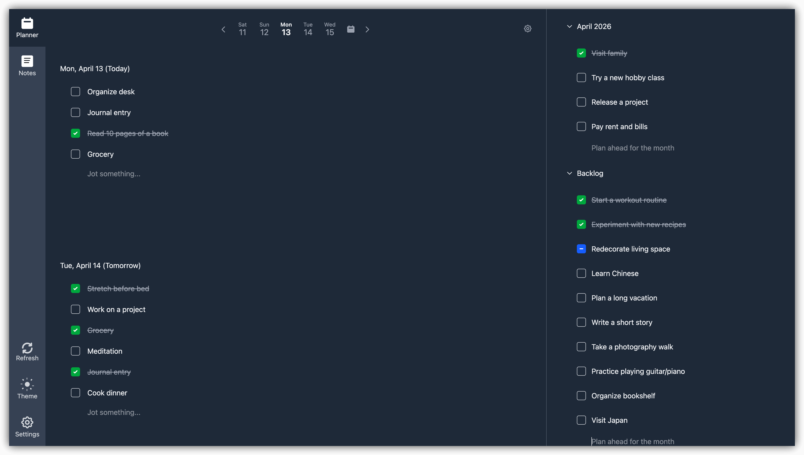
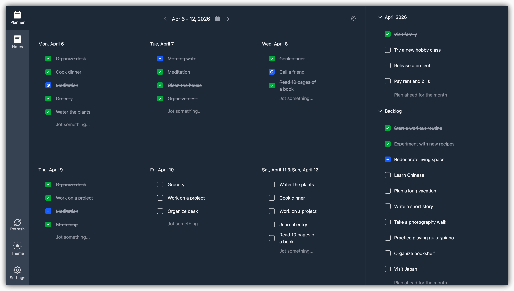
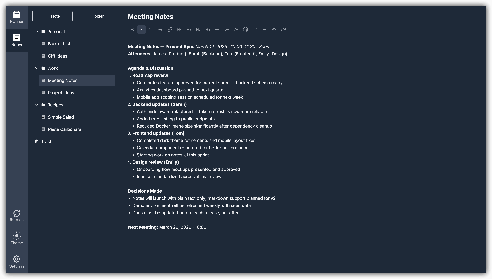

# Introduction to Perga

Perga is a personal workspace for notes, plans, and ideas.

## Project Components

Perga consists of two main components:

1. **[Perga API](https://github.com/getperga/perga-api)** stores your data and handles requests.
2. **[Perga Web](https://github.com/getperga/perga-web)** lets you use Perga in a browser.

## Screenshots

  
  &nbsp;&nbsp;&nbsp;
  
  &nbsp;&nbsp;&nbsp;
  
  &nbsp;&nbsp;&nbsp;
  

## Demo

Try Perga without installing it at [demo.getperga.me](https://demo.getperga.me/).

To run Perga on your own server, follow the [installation guide](./installation.md).

## Features

- **Daily planning**: Plan your days
- **Monthly and custom agendas**: Plan ahead and keep long-term goals organized
- **Notes**: Organize notes in folders, pin important notes for quick access,
  search their contents, and import or export them
- **Authentication**: Sign in with a password or Google
- **Responsive interface**: Use Perga on desktop or mobile, install it as a PWA, and switch to a dark theme

## Documentation Structure

- [Perga API](./perga-api): Setup, endpoints, and development.
- [Perga Web](./perga-web): Setup, features, and development.
